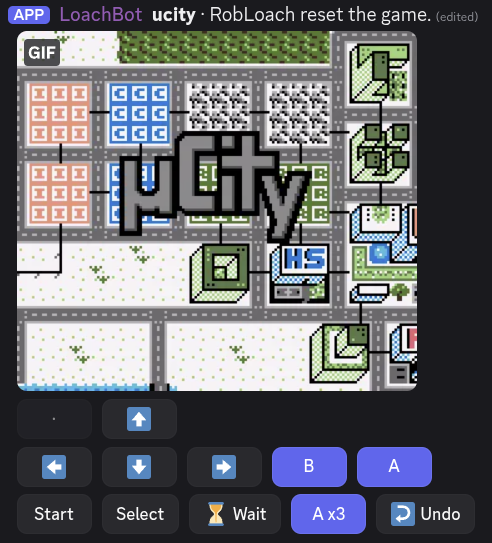

# robloach-cogs

Cogs for [Red-DiscordBot](https://github.com/Cog-Creators/Red-DiscordBot).

| Cog | Description |
| --- | --- |
| [Retro](retro) | Play retro console games in Discord |

## Retro

With the [Retro](retro) cog, you're able to play retro console games directly within a channel, with Discord buttons for a controller. Every interaction posts a clip of the next second of gameplay.



```
[p]repo add robloach-cogs https://github.com/RobLoach/robloach-cogs
[p]cog install robloach-cogs retro
[p]load retro
```

## Development

```
pip install -r requirements-dev.txt
pytest                      # the fast suite, the default: ~10s
pytest -m emulator          # the real-core half: ~30s, or ~16s with -n 2
ruff check .
```

## License

Copyright (C) 2026 Rob Loach. GPL-3.0-or-later; see [LICENSE](LICENSE).
